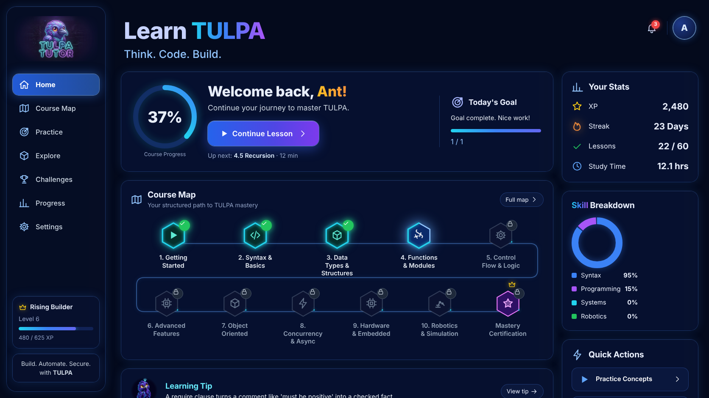
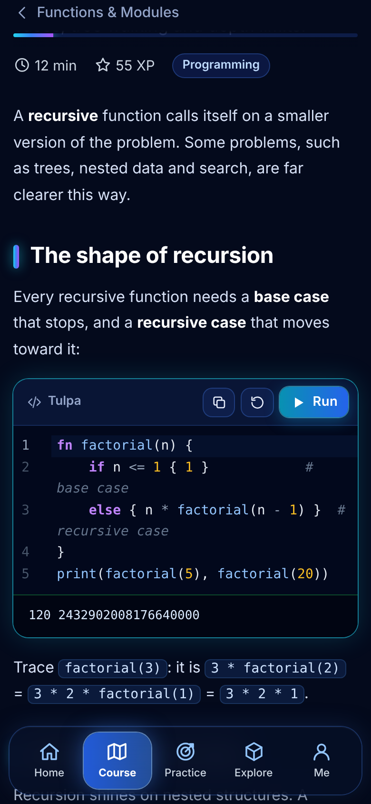
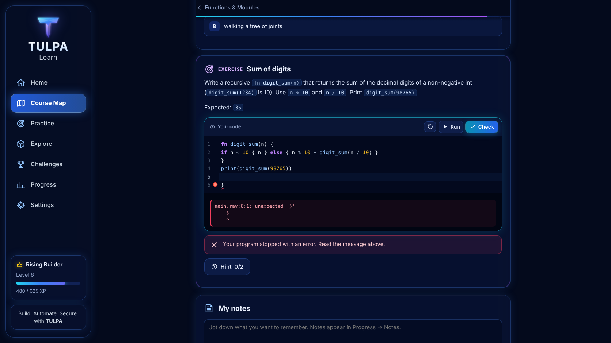
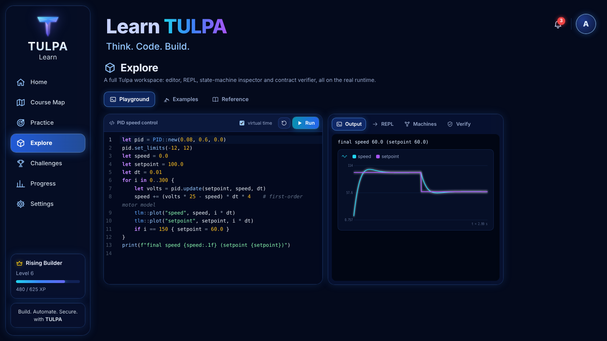

# TulpaTutor

**Learn [Tulpa](https://github.com/LoQiseaking69/Tulpa), the language for robotics and
embedded systems, with the real runtime running on your device.** Web app, Android and iOS.

<p align="center">
  
  
</p>
<p align="center">
  
  
</p>

Every snippet, exercise, challenge and exam question runs on **Tulpa 3.5 compiled to
WebAssembly**: the same interpreter, bytecode VM, units, contracts, state machines, signals,
simulated hardware bus and `std/` library that `tulpa` uses on a desktop. No server.

## What's inside

| | |
|---|---|
| **Course** | 10 modules, 60 in-depth lessons, from `print` to autonomous robots: 306 runnable, editable snippets, 60 checked exercises, 122 quiz questions, key takeaways |
| **Mastery Certification** | 20 questions drawn from a 32-question pool + 3 capstone programs checked by the runtime; a certificate you can save as an image |
| **Practice** | spaced-repetition review (Leitner boxes), code drills from finished lessons, timed lightning rounds |
| **Challenges** | 14 standalone problems (easy → hard) with hidden tests |
| **Explore** | a full workspace: editor with live diagnostics and completion, REPL, state-machine diagrams, contract fuzzing (`check`) and `define_test!` runner, 10 example programs, a searchable language reference |
| **Live instruments** | `tlm::plot(name, value, t)` draws animated charts under the output |
| **Progress** | XP and levels, streaks, study time, skill breakdown (Syntax / Programming / Systems / Robotics), 14 achievements, notes with each lesson's takeaways |
| **The Tutor** | a robotic-raven mascot who greets you, cheers passed exercises, reacts to mistakes and delivers hints (poses in `assets/brand/`) |
| **Feel** | animated course map, progress rings, confetti, sparks, ripples, scroll reveals and celebrations; haptic ticks as XP counts up; native haptics on Android/iOS (Capacitor Haptics) and vibration on the web; respects reduced motion |

Modules: Getting Started · Syntax & Basics · Data Types & Structures · Functions & Modules ·
Control Flow & Logic · Advanced Features · Object Oriented · Concurrency & Async ·
Hardware & Embedded · Robotics & Simulation · Mastery Certification.

## Brand

`assets/brand/` holds the TulpaTutor logo and four Tutor poses (wave, think, celebrate,
oops). The poses were generated to match the logo; full-resolution versions are in the
Figma file *TulpaTutor mascot poses*. `scripts/make-brand.sh` regenerates every app icon,
splash screen and web image from these.

On launch, an animated startup (`web/src/ui/intro.js`) powers up the wings-spread logo
(`assets/brand/tulpatutor-startup.jpg`): circuits charge, the Tutor rises and flaps, red
lightning ignites the wordmark, with haptics at each beat. The native launch screens are
plain black so they hand off to it seamlessly. Tap to skip; reduced motion (system or the
in-app setting) gets a short fade.

## Layout

```
runtime/            Rust cdylib: C-ABI bridge from tulpa::embed to WebAssembly (no wasm-bindgen)
  shim/             wtime.rs (browser clock) and wfs.rs (in-memory /std and /work files)
scripts/
  build-wasm.sh     fetch Tulpa at TULPA_REF, patch, build web/public/tulpa/tulpa.wasm + stdlib.json
  patch_tulpa_wasm.py   the wasm patch (behaviour-neutral on native targets)
  check-course.mjs  runs the whole course against the runtime (CI gate)
  tulpa-run.mjs     run a .rav file on the wasm runtime from Node
  make-brand.sh     build Android/iOS icons, splash screens and web brand images from assets/brand
web/                the app (Vite, vanilla JS, CodeMirror 6, Capacitor)
  src/course/       lessons as Markdown (NN-module/NN-lesson.md), challenges.json, exam.json
  src/runtime/      core.js (loader), worker.js (runs programs off the UI thread), client.js
  src/views/        home, map, lesson, practice, explore, challenges, progress, settings, cert
android/  ios/      Capacitor 7 native projects (dev.hermitech.tulpatutor)
content-src/        Python sources for challenges.json and exam.json
TULPA_REF           the Tulpa commit the app is built against
VERSION             app version; bump on main to publish a release
```

## Building

```sh
rustup target add wasm32-unknown-unknown
scripts/build-wasm.sh                 # or TULPA_SRC=../Tulpa scripts/build-wasm.sh
cd web && npm ci
node ../scripts/check-course.mjs      # every snippet, exercise, quiz and example
npx vite                              # dev server
npx vite build                        # web/dist: static site
npx cap sync                          # copy into android/ and ios/
```

- **Android**: `cd android && ./gradlew assembleRelease` (JDK 21, Android SDK). Signed with
  `android/keystore.properties` if present, otherwise the debug key.
- **iOS**: open `ios/App/App.xcodeproj` in Xcode 16 (Swift Package Manager, iOS 15+).

## CI and releases

`.github/workflows/build.yml` builds the wasm runtime, validates the course, builds the web
app (deployed to GitHub Pages), an APK and an unsigned IPA. Bumping `VERSION` on `main` (or
pushing a `v*` tag) publishes a release with the APK, IPA and a web zip.

Repository secrets for a release-signed APK (same names as Tulpa Field):
`KEYSTORE_BASE64`, `KEYSTORE_PASSWORD`, `KEY_ALIAS`, `KEY_PASSWORD`. Enable **Pages → Source:
GitHub Actions** in the repository settings for the web deployment.

The IPA is ad-hoc signed for sideloading with AltStore, SideStore or Sideloadly.

## Writing lessons

A lesson is Markdown with front matter and a few block types; see the header of
`web/src/course/parse.js`:

- ` ```tulpa ` runnable snippet (` ```tulpa error `, `realtime`, `repl`, `static` variants)
- ` ```quiz ` with `?` question, `-` wrong, `+` right, `>` explanation
- `:::exercise Title` with ` ```tulpa starter `, ` ```tulpa solution `, ` ```expect `, ` ```check `, ` ```hint `
- `:::note`, `:::tip`, `:::warn`, `:::deep`, `:::takeaways` callouts

`node scripts/check-course.mjs` must pass: every solution must produce its expected output and
pass its hidden checks, and every starter must *not* already pass.

## Runtime notes

The browser build is Tulpa at `TULPA_REF` with a small patch (`scripts/patch_tulpa_wasm.py`):
`std::time` and `std::thread::sleep` route to the browser clock, imports and `read_file` use an
in-memory store holding `std/` and `/work`, telemetry is always on, and recursion is capped
at 400 frames (browser stacks are ~1 MB). On native targets the patch changes nothing.

Known Tulpa 3.5.0 issues the course works around (worth fixing upstream):

- `assert!(cond)` parses as `assert !(cond)` (the keyword wins), so it checks the opposite.
  Lessons use `assert cond` and `assert_eq!`.
- A task error caught around `await` is re-raised when the program exits.
- `if`-expressions accept `else if` but not `elif` (statement-form `if` accepts both).

## License

[Business Source License 1.1](LICENSE), HermiTech LLC, like Tulpa itself.
